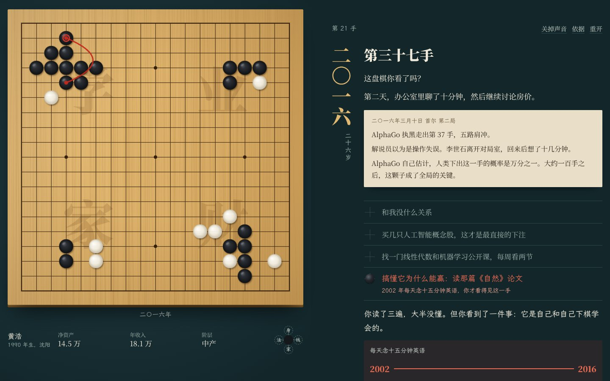
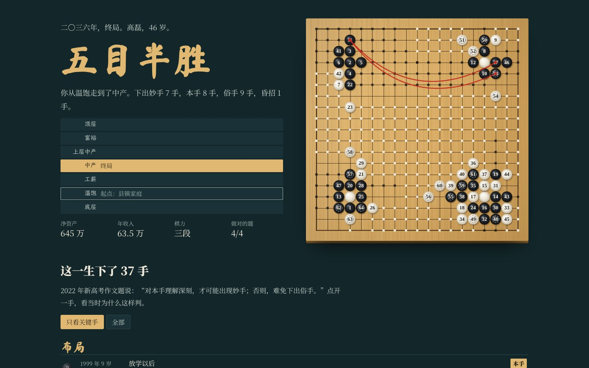

# 选择决定命运

一局和时代下的围棋。选一个出生年份和家庭，出身决定让几子，后面每一手都算你自己的。

在线体验：[https://wanglu2016.github.io/xuanze-jueding-mingyun/](https://wanglu2016.github.io/xuanze-jueding-mingyun/)

介绍片（2 分 57 秒）：[在线观看](https://wanglu2016.github.io/xuanze-jueding-mingyun/video.html)，或[下载视频](https://github.com/wanglu2016/xuanze-jueding-mingyun/raw/main/video/xuanze-jueding-mingyun.mp4)

[](assets/shots/home.jpg)

## 这是什么

受[《普通中国人的一生》](https://github.com/wanglu2016/putong-yisheng)启发。那一部让你看见选项怎样被划掉，这一局想让你看见，积累怎样写下新的选项。

你可以生在 1980、1985、1990、1995、2000、2005、2010 年，生在农村、县镇、工人、知识分子、小老板或富裕家庭里。每一手都是那一年真实发生过的事：中专包分配取消、入世、淘宝上线、2007 年和 2015 年的牛市、P2P、币圈、断卡行动、双减、房企暴雷、ChatGPT。2027 年以后是推演。

一局约 15 到 25 分钟，手机和电脑都能玩。

## 怎么玩

- **让子：** 出身决定开局。富裕家庭你先摆九子，农村务农家庭时代先摆六子。可以自己选，也可以“猜先”，按当年真实的城乡比例抽签。
- **黑子和白子：** 你点一个选项，棋盘上落一颗黑子；时代的大事是白子。棋盘四个角是人生的四块地：学、业、家、财。
- **选项不标好坏：** 很多选择要过十年才见分晓。错的选项也写得很有道理，就像当年的人听到的那样。
- **被划掉的选项：** 红是制度，蓝是家境，紫是性别，灰是时机或分数。点一下能看原因。
- **朱批：** 小时候念的英语、自学的编程，多年后会写出一个别人看不见的红字选项，棋盘上画出一条红线，把当年那颗子和现在连起来。
- **四口气：** 身体、现金流、家庭、法律。法律这口气，要懂一点法才看得见它没了。
- **案发：** 来钱快的选项可能触犯法律，判决晚几年才到，引用真实的法条。
- **读秒、找雷、算账：** 骗局会催你；有的地方要读合同条款、算年化和杠杆。
- **复盘：** 每一手判为本手、妙手、俗手或昏招，附当时更好的下法；还有你接住的伏笔、没看见的选项、认知体检，以及和一千个同样出身的你比一比。

[](assets/shots/zhu.jpg)

[](assets/shots/crossed.jpg)

[](assets/shots/review.jpg)

## 下载

- 离线版：[xuanze-jueding-mingyun-site.zip](https://github.com/wanglu2016/xuanze-jueding-mingyun/raw/main/download/xuanze-jueding-mingyun-site.zip)。解压后双击 index.html 即可，不需要联网。
- 介绍片：[xuanze-jueding-mingyun.mp4](https://github.com/wanglu2016/xuanze-jueding-mingyun/raw/main/video/xuanze-jueding-mingyun.mp4)，1080p，约 43 MB，字幕已压进画面；[单独的字幕文件](https://github.com/wanglu2016/xuanze-jueding-mingyun/raw/main/video/xuanze-jueding-mingyun.srt)。

## 注意事项

- 这是依据公开资料做的交互作品，不是研究报告，也不是投资或法律建议。
- 人物、对话和具体金额是虚构的。收入、房价、阶层门槛是作者按公开数据折算或设定的。
- 2027 年以后的内容全部是推演，不是预测，棋子带虚线。
- “一千个平行的你”是用同一套规则模拟的普通玩法，只说明游戏规则，不代表真实统计。
- 文中引用《刑法》条文只为说明风险，具体案件以法律和司法机关认定为准。遇到高薪招工、出借银行卡、高息理财，可以拨打全国反诈专线 96110。
- 历史年份和数字多依据公开报道和常识写成，没有逐条核对原始文件，发布到更大范围前建议再核一遍。
- 进度和战绩只保存在你自己的浏览器里。
- 介绍片的旁白由作者本人的声音样本合成，接近但不完全相同。声音样本不在这个仓库里。

## 数据来源与许可

| 内容 | 来源 |
|---|---|
| 城镇单位平均工资 | 国家统计局历年《中国统计年鉴》；2025 年非私营单位 129441 元（2026 年 5 月发布） |
| 人口、出生、城镇化率 | 国家统计局；2025 年末总人口 14.05 亿，出生 792 万 |
| 高考报名与录取、高校毕业生 | 教育部；2026 年高考报名 1290 万，2026 届毕业生 1270 万 |
| 青年失业率 | 国家统计局；2026 年 9 月 16 至 24 岁（不含在校生）18% |
| 上证指数、比特币、纳斯达克 | 历年年末收盘的公开数据；2026 年为估算 |
| 房价 | 按公开均价和指数折算的估算，只用来画出大致形状 |
| 法律条文 | 《刑法》第一百四十条、第一百七十六条、第一百九十二条、第二百二十四条之一、第二百六十六条、第二百八十七条之二；《妇女权益保障法》（2022 修订） |
| 政策文件 | 2008 年首付与利率下调、2016 年叫停首付贷、2017 年校园贷整治、2017 年《关于防范代币发行融资风险的公告》、2020 年“三道红线”、2020 年断卡行动、2021 年“双减”、2020 年民间借贷司法解释 |
| 作文题 | 2022 年普通高考语文新高考Ⅰ卷（本手、妙手、俗手） |
| 字体 | 思源宋体、霞鹜文楷、马善政楷书，均为 SIL Open Font License 1.1，见 [assets/fonts/README.md](assets/fonts/README.md) |

游戏里每一手的“依据”在复盘里点开可见，分制度、统计、估算、虚构四层；完整列表在游戏的“依据与方法”页。

## 目录结构

```
index.html              游戏入口
video.html              介绍片页面
assets/js/series.js     年度数据、家庭、城市、阶层
assets/js/engine.js     人生引擎，不依赖网页，可在 Node 里批量模拟
assets/js/content/      全部剧情节点，按年代分文件
assets/js/board.js      棋盘、棋子、红线和落子声（Canvas、Web Audio）
assets/js/ui.js         界面编排和复盘
assets/css/             样式和字体声明
assets/fonts/           按实际用字裁剪的字体
assets/shots/           截图
tools/                  模拟、查重、浏览器测试、字体裁剪，见 tools/README.md
tools/film/             介绍片的制作脚本
video/                  介绍片、字幕和封面
download/               离线包
```

## 本地运行

双击 index.html，或者：

```
python3 -m http.server
```

然后打开 [http://localhost:8000](http://localhost:8000)。改了剧情以后，运行 `node tools/simulate.js 30` 和 `node tools/repeat.js 8 .42` 检查全部路径，说明见 [tools/README.md](tools/README.md)。
